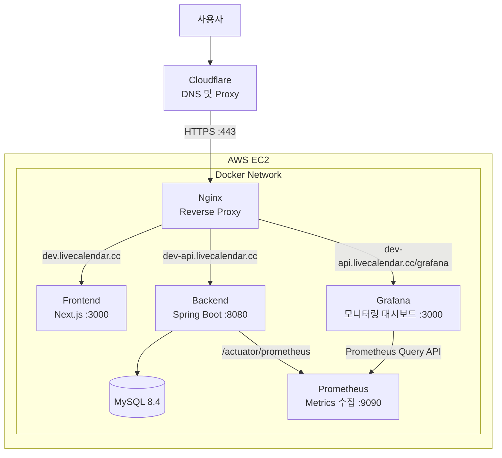
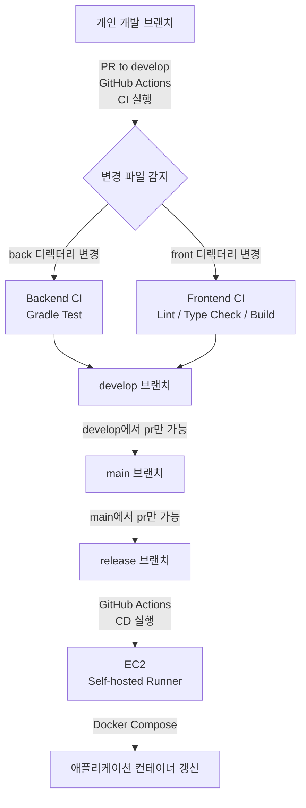

# Live-Calendar

해당 README 문서에서는 프로젝트 전체에 해당하는 내용만 기술합니다.

프론트에 관련된 내용은 [프론트 README](front/README.md)  
백엔드에 관련된 내용은 [백엔드 README](back/README.md)  
에서 확인합니다.
 

## 프로젝트 개요

Live-Calendar는 일정을 공유, 구독, 조율 할 수 있게 해주는 일정 플랫폼 서비스입니다.

## 서비스 도메인 

### `https://livecalendar.cc`

| URL | 용도 |
|---|---|
| [`dev.livecalendar.cc`](https://dev.livecalendar.cc) | 프론트엔드 진입점입니다. |
| [`dev-api.livecalendar.cc`](https://dev-api.livecalendar.cc) | 백엔드 진입점입니다. |
| [`/swagger-ui.html`](https://dev-api.livecalendar.cc/swagger-ui.html) | Swagger UI 진입점입니다. |
| [`/v3/api-docs`](https://dev-api.livecalendar.cc/v3/api-docs) | OpenAPI 명세를 JSON으로 제공합니다. |
| [`/grafana`](https://dev-api.livecalendar.cc/grafana) | Grafana UI 진입점입니다. |

## AWS 기반 서비스 배포 환경 구성

### 1. 배포 아키텍처

AWS EC2에 Docker 기반으로 프론트엔드와 백엔드 애플리케이션을 배포했습니다.  
Nginx를 리버스 프록시로 사용하여 도메인에 따라 각 애플리케이션으로 요청을 전달하도록 구성했습니다.

Cloudflare를 통해 DNS 및 HTTPS를 관리하고, Cloudflare Origin CA 인증서를 적용하여 Cloudflare와 EC2 간의 HTTPS 통신을 구성했습니다.

### 2. 기술 스택

| 구분 | 기술 |
|---|---|
| Cloud | AWS EC2 |
| OS | Ubuntu |
| Container | Docker, Docker Compose |
| Reverse Proxy | Nginx |
| Frontend | Next.js |
| Backend | Spring Boot |
| Database | MySQL 8.4 |
| DNS 및 Proxy | Cloudflare |
| SSL 인증서 | Cloudflare Origin CA |
| Network | Docker Bridge Network |

### 3. 도메인 및 요청 라우팅

| 도메인 | 대상 | 설명 |
|---|---|---|
| `dev.livecalendar.cc` | Frontend | Next.js 서비스 |
| `dev-api.livecalendar.cc` | Backend | Spring Boot API |
| `dev-api.livecalendar.cc/grafana` | Grafana | Grafana 대시보드 |

### 4. HTTPS 및 보안 구성

- Cloudflare DNS를 통한 도메인 관리
- Cloudflare Proxy를 통한 외부 요청 처리
- Cloudflare Origin CA 인증서 적용
- Cloudflare SSL/TLS 모드 `Full (strict)` 설정
- `Always Use HTTPS` 활성화
- Nginx에서 HTTP 및 HTTPS 요청 처리
- 백엔드 포트(8080)는 외부에 직접 공개하지 않고 Docker 내부 네트워크에서만 접근하도록 구성
- EC2 보안 그룹에서 필요한 포트만 허용

| 포트 | 용도 | 접근 범위 |
|---|---|---|
| 22 | SSH | 관리자 IP 제한 |
| 80 | HTTP | 외부 요청 |
| 443 | HTTPS | 외부 요청 |
| 3000 | Frontend | Docker 내부 |
| 8080 | Backend | Docker 내부 |
| 3306 | MySQL | Docker 내부 |

---

## GitHub Actions 기반 CI/CD 자동화

### 1. CI/CD 파이프라인

GitHub Actions를 활용하여 Pull Request 단계에서 프론트엔드와 백엔드의 코드 품질 및 빌드를 검증하고, 배포 브랜치의 코드를 EC2 환경에 반영하는 자동화 구조를 구성했습니다.

